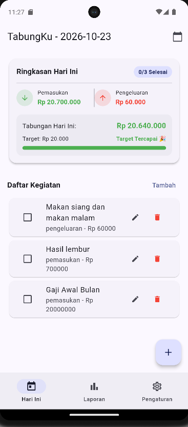
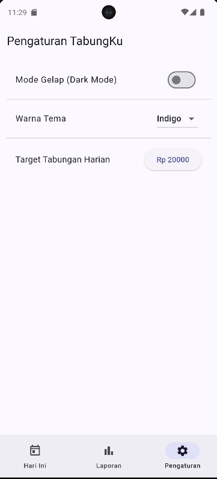

# Laporan Praktikum Pemrograman Mobile - Pertemuan 7
**Mata Kuliah:** Pemrograman Mobile  
**Pertemuan:** 7 (Aplikasi "TabungKu" - SQLite, State Management Provider, & SharedPreferences)  

---

### Identitas Mahasiswa
- **Nama:** Wilson Fabian  
- **NIM:** 20240801098  

---

## 1. Deskripsi Tugas & Praktikum
Pada Pertemuan 7 ini, praktikum berfokus pada pembangunan aplikasi mobile komprehensif berbasis Flutter bernama **TabungKu**. Aplikasi ini dirancang sebagai pengelola keuangan harian dan pencatat kegiatan dengan fitur-fitur lanjutan sebagai berikut:
1. **Database Lokal (SQLite / `sqflite`)**: Menyimpan data kegiatan harian, status selesai, jenis keuangan (pemasukan/pengeluaran/tanpa uang), nominal, dan kategori pengeluaran secara persisten di perangkat.
2. **State Management (`Provider` & `SharedPreferences`)**: Mengelola state global aplikasi seperti mode gelap (*dark mode*), pemilihan warna tema (*seed color*), dan target tabungan harian yang tersimpan otomatis.
3. **Format Mata Indonesia (`intl`)**: Menampilkan format mata uang Rupiah (`Rp`) dan penanggalan bahasa Indonesia secara rapi.
4. **Navigasi & UI Modern**: Menggunakan Material 3, `NavigationBar` (Bottom Navigation), `IndexedStack`, serta berbagai widget interaktif (`RingkasanCard`, `DatePicker`, `AlertDialog`).

---

## 2. Dokumentasi Tampilan & Penjelasan Fitur

Berikut adalah hasil tangkapan layar (*screenshot*) beserta penjelasan dari masing-masing fitur utama aplikasi TabungKu:

### 2.1 Halaman Beranda / Hari Ini (`hari ini.png`)
Halaman utama menampilkan ringkasan keuangan harian (`RingkasanCard`) yang mencakup total pemasukan, total pengeluaran, status pencapaian target tabungan, indikator progress bar, serta daftar kegiatan harian yang dilengkapi dengan *checkbox* status selesai, tombol ubah, dan hapus. Pengguna juga dapat mengganti tanggal aktif menggunakan ikon kalender di AppBar.


---

### 2.2 Validasi Form & Pesan Kesalahan (`Form Pesan Kesalahan.png`)
Form tambah dan ubah kegiatan dilengkapi dengan validasi input yang ketat (misalnya nama kegiatan wajib diisi, nominal keuangan harus berupa angka positif `> 0`, serta pilihan kategori pengeluaran seperti Makan, Transport, Belajar, Hiburan, dan Lainnya). Jika input tidak valid, aplikasi akan menampilkan pesan kesalahan secara *real-time*.


---

### 2.3 Indikator Tabungan Minus / Peringatan (`Tabungan Minus.png`)
Ketika total pengeluaran melebihi total pemasukan pada hari tersebut, kartu ringkasan secara otomatis mendeteksi kondisi tabungan negatif, mengubah warna indikator menjadi merah, dan menampilkan peringatan *"Peringatan: Tabungan Negatif!"*.


---

### 2.4 Halaman Laporan Keuangan (`Laporan.png`)
Halaman laporan menyajikan rekapitulasi keuangan secara keseluruhan pada tanggal yang dipilih, meliputi total kegiatan selesai, total pemasukan, total pengeluaran, saldo tabungan akhir, serta rincian **Pengeluaran per Kategori** agar pengguna dapat memantau alokasi pengeluaran harian mereka dengan mudah.



---

### 2.5 Halaman Pengaturan (`Pengaturan.png`)
Halaman pengaturan memungkinkan pengguna untuk mengatur preferensi aplikasi secara dinamis, seperti mengaktifkan Mode Gelap (*Dark Mode*), memilih warna tema utama aplikasi (Indigo, Blue, Green, Teal, Purple, Orange), serta mengubah target tabungan harian melalui dialog *pop-up*.



---

### 2.6 Tampilan Mode Gelap / Dark Mode (`Mode Gelap.png`)
Tangkapan layar berikut menunjukkan antarmuka aplikasi TabungKu saat fitur Mode Gelap (*Dark Mode*) diaktifkan melalui halaman pengaturan, memberikan kenyamanan visual bagi pengguna di lingkungan minim cahaya.


---

## 3. Daftar Fitur & Implementasi

| Kode | Fitur Wajib | Implementasi di Aplikasi | Status |
| :--- | :--- | :--- | :---: |
| **F1** | Daftar kegiatan hari ini: centang selesai, ubah, hapus dengan konfirmasi | `BerandaPage` + `Checkbox` & tombol aksi; judul dicoret bila selesai; dialog konfirmasi hapus kegiatan | ✅ Selesai |
| **F2** | Form tambah/ubah: nama, tanggal, jenis keuangan, nominal, kategori; tervalidasi | `FormKegiatanPage` dengan `TextFormField` & `DropdownButtonFormField`; validasi nominal `> 0` dan kategori bersyarat | ✅ Selesai |
| **F3** | Data tersimpan di SQLite | `DbHelper`, tabel `kegiatan` di database lokal `tabungku.db` | ✅ Selesai |
| **F4** | Ringkasan hari ini | `RingkasanCard`: rasio selesai/total, total pemasukan, total pengeluaran, saldo tabungan | ✅ Selesai |
| **F5** | Laporan: pilih tanggal, ringkasan, pengeluaran per kategori | `LaporanPage`: pemilihan tanggal, kartu ringkasan, dan rekapitulasi pengeluaran per kategori | ✅ Selesai |
| **F6** | Target tabungan harian + indikator kemajuan beranimasi | `RingkasanCard`: `LinearProgressIndicator` dengan animasi, indikator target tercapai (`🎉`) atau peringatan minus | ✅ Selesai |
| **F7** | Pengaturan: mode gelap, warna tema, target; tersimpan | `PengaturanPage` + `PengaturanProvider` & `SharedPreferences` untuk menyimpan preferensi | ✅ Selesai |
| **F8** | Tiga tab (NavigationBar) dan form lewat named route | `ShellPage` + `IndexedStack` (Hari Ini, Laporan, Pengaturan); navigasi `/form` menggunakan argument | ✅ Selesai |

---

## 4. Aturan Bisnis (Business Rules)
1. **Jenis Keuangan & Nominal**: Kegiatan dapat dipilih antara *"Tidak Melibatkan Uang"*, *"Pemasukan"*, atau *"Pengeluaran"*. Jika memilih pemasukan atau pengeluaran, nominal wajib diisi berupa angka bulat positif (`> 0`).
2. **Kategori Pengeluaran**: Pilihan kategori pengeluaran (*Makan, Transport, Belajar, Hiburan, Lainnya*) hanya muncul dan wajib diisi apabila jenis keuangan yang dipilih adalah **Pengeluaran**.
3. **Tabungan & Target Harian**: Tabungan dihitung dari total pemasukan dikurangi total pengeluaran pada tanggal tersebut (`Tabungan = Pemasukan - Pengeluaran`). Jika tabungan mencapai atau melebihi target tabungan harian, status menunjukkan *"Target Tercapai 🎉"*. Jika tabungan bernilai negatif, aplikasi menampilkan *"Peringatan: Tabungan Negatif!"*.
4. **Persistensi Data**: Seluruh data transaksi dan kegiatan yang ditambahkan, diubah, maupun dihapus akan langsung memperbarui database SQLite dan memicu pembaruan UI secara reaktif.

---

## 5. Rancangan Data (Database Schema)
Aplikasi menggunakan database SQLite bernama `tabungku.db` dengan satu tabel utama yaitu **`kegiatan`**:

| Nama Kolom | Tipe Data SQLite | Keterangan / Batasan |
| :--- | :--- | :--- |
| `id` | `INTEGER` | Primary Key, Auto Increment |
| `judul` | `TEXT` | Nama / deskripsi kegiatan (NOT NULL) |
| `tanggal` | `TEXT` | Format `yyyy-MM-dd` (NOT NULL) |
| `selesai` | `INTEGER` | Status selesai (`1` = true, `0` = false) |
| `tipe` | `TEXT` | `'tanpa'`, `'pemasukan'`, atau `'pengeluaran'` |
| `nominal` | `INTEGER` | Jumlah nominal uang (Default `0`) |
| `kategori` | `TEXT` | `'Makan'`, `'Transport'`, `'Belajar'`, `'Hiburan'`, `'Lainnya'`, atau `'-'` |

---

## 6. Cara Menjalankan Aplikasi
1. Pastikan Flutter SDK dan Emulator Android (misal: `emulator-5554`) sudah siap dan aktif.
2. Buka terminal pada direktori utama proyek (`/root/perkuliahan/pemrograman_mobile/pemob/`).
3. Jalankan perintah untuk mengambil dependensi (jika diperlukan):
   ```bash
   flutter pub get
   ```
4. Jalankan aplikasi menggunakan perintah berikut:
   ```bash
   flutter run -d emulator-5554 -t lib/pert_7/Praktikum7/lib/main.dart
   ```

---

## 7. Tabel Hasil Skenario Uji Coba (Testing)

| No | Skenario Pengujian | Langkah Pengujian | Hasil yang Diharapkan | Hasil Pengujian |
| :---: | :--- | :--- | :--- | :---: |
| 1 | **Tambah Kegiatan (Tanpa Uang)** | Buka tab Beranda -> Klik Tambah -> Isi judul -> Pilih jenis "Tidak Melibatkan Uang" -> Simpan. | Kegiatan berhasil tersimpan dan tampil di daftar harian tanpa nominal. | **PASS** |
| 2 | **Validasi Form Kosong** | Buka form tambah -> Biarkan judul kosong -> Klik Simpan. | Muncul pesan kesalahan "Wajib diisi" pada TextFormField. | **PASS** |
| 3 | **Tambah Pemasukan** | Tambah kegiatan baru -> Pilih jenis "Pemasukan" -> Masukkan nominal 50.000 -> Simpan. | Saldo pemasukan dan ringkasan tabungan bertambah sebesar Rp 50.000. | **PASS** |
| 4 | **Pengeluaran & Kategori** | Tambah kegiatan baru -> Pilih jenis "Pengeluaran" -> Input nominal 15.000 -> Pilih kategori "Makan" -> Simpan. | Pengeluaran tercatat, kategori tersimpan, dan masuk ke menu Laporan per Kategori. | **PASS** |
| 5 | **Status Selesai Kegiatan** | Beri centang (*checkbox*) pada salah satu item kegiatan di daftar. | Judul kegiatan berubah menjadi tercoret (*line-through*) dan jumlah selesai bertambah. | **PASS** |
| 6 | **Uji Coba Tabungan Minus** | Tambah pengeluaran yang lebih besar daripada pemasukan hari itu. | Kartu ringkasan berubah warna menjadi merah dengan peringatan "Tabungan Negatif!". | **PASS** |
| 7 | **Pengaturan Tema & Dark Mode** | Pindah ke tab Pengaturan -> Aktifkan "Mode Gelap" -> Ganti warna tema ke Green. | Tampilan aplikasi berubah secara instan ke mode gelap dengan aksen warna hijau. | **PASS** |

---

## 8. Pertanyaan Refleksi (Modul Praktikum)
1. **Bagaimana cara kerja sinkronisasi data reaktif antara database SQLite dan UI Flutter di aplikasi TabungKu?**  
   *Jawab:* Sinkronisasi dilakukan menggunakan `ValueNotifier<int> versiData` di dalam `DbHelper`. Setiap kali ada operasi penambahan, pembaruan, atau penghapusan data (`tambah`, `ubah`, `hapus`), fungsi `_notifikasiPerubahan()` akan menaikkan nilai `versiData`. Di `BerandaPage`, kita mendaftarkan `listener` pada `versiData` di `initState` sehingga setiap kali nilai versi berubah, halaman akan otomatis memanggil ulang fungsi pemuatan data (`_muat()`) dan memperbarui UI secara reaktif tanpa perlu *restart* aplikasi.

2. **Mengapa penggunaan `Provider` dan `SharedPreferences` sangat penting dalam pengelolaan preferensi pengguna?**  
   *Jawab:* `SharedPreferences` memungkinkan data preferensi seperti status *Dark Mode*, pilihan warna tema, dan target tabungan harian tersimpan secara persisten di penyimpanan lokal perangkat meskipun aplikasi ditutup. Sedangkan `Provider` bertindak sebagai *state management* reaktif yang mendistribusikan perubahan preferensi tersebut ke seluruh widget pohon aplikasi secara efisien, sehingga saat pengguna mengubah pengaturan di `PengaturanPage`, seluruh tampilan aplikasi langsung beradaptasi seketika tanpa jeda.

3. **Apa keuntungan menggunakan `IndexedStack` dibandingkan `Navigator` biasa untuk navigasi berbasis *Bottom Navigation Bar* (`ShellPage`)?**  
   *Jawab:* Keuntungan utama menggunakan `IndexedStack` adalah **mempertahankan state (keadaan) dari setiap halaman tab** yang sudah dibuka. Ketika pengguna berpindah dari tab Beranda ke tab Laporan lalu kembali lagi ke Beranda, data, posisi *scroll*, dan pilihan tanggal pada tab Beranda tidak akan hilang atau dimuat ulang dari awal (`initState` tidak dipanggil ulang), sehingga memberikan pengalaman pengguna (*user experience*) yang jauh lebih mulus dan responsif.