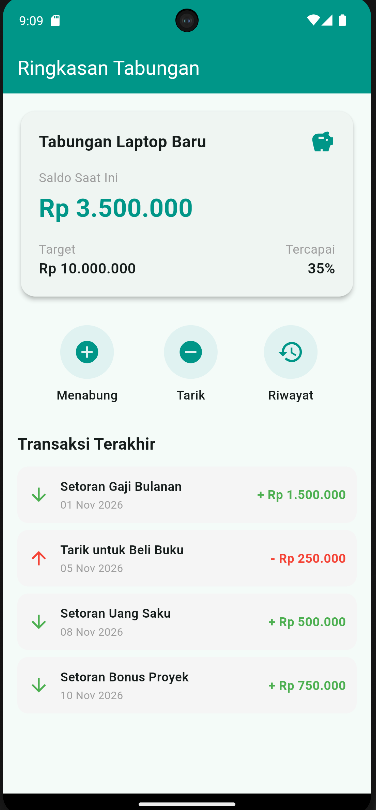
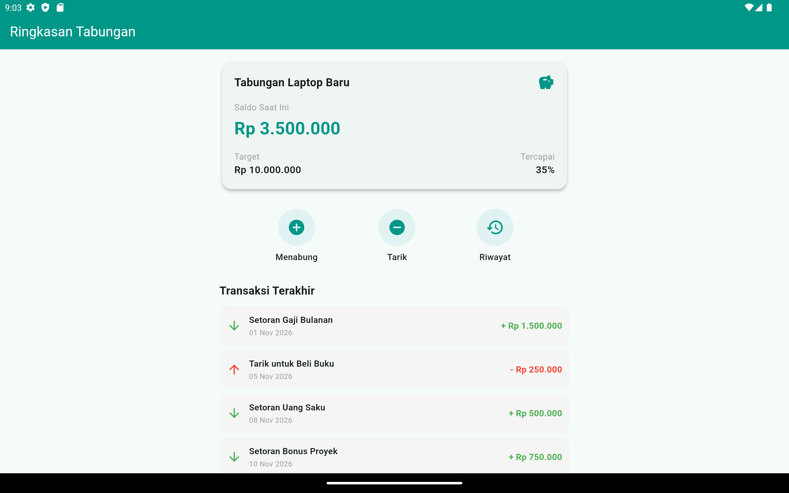

# TabungKu Layout

Tugas Minggu 3 – TI505 Pemrograman Mobile  
**Menyusun Layout dengan Widget Dasar Flutter** (Sub-CPMK-1.1)

---

## Identitas

| Keterangan | Data |
|---|---|
| Nama | Wilson Fabian |
| NIM | 20240801098 |
| Kelas | Pemrograman Mobile |

---

## Deskripsi

`tabungku_layout` adalah aplikasi Flutter sederhana yang menampilkan layar **Ringkasan Tabungan** untuk aplikasi TabungKu. Fokus tugas ini adalah menyusun tata letak (*layout*) menggunakan widget dasar Flutter, tanpa paket pihak ketiga.

## Fitur Tampilan

| No | Komponen | Widget Utama |
|---|---|---|
| 1 | Judul halaman "Ringkasan Tabungan" | `Scaffold`, `AppBar` |
| 2 | Kartu informasi tabungan (nama, saldo, target) | `Card`, `Column`, `Row` |
| 3 | Tiga tombol kategori: Menabung, Tarik, Riwayat | `Row`, `InkWell`, `Container`, `Icon` |
| 4 | Daftar 4 transaksi (judul, tanggal, nominal) | `Column`, `Row`, `Expanded` |

Transaksi masuk ditandai warna hijau dengan tanda `+`, sedangkan penarikan ditandai warna merah dengan tanda `-`.

---

## Struktur Layout

Hierarki widget pada halaman `RingkasanPage`:

```
Scaffold
├── AppBar ("Ringkasan Tabungan")
└── body: SingleChildScrollView
    └── Center
        └── ConstrainedBox (maxWidth: 600)
            └── Padding
                └── Column
                    ├── KartuTabungan       -> Card > Container > Column > Row
                    ├── SizedBox
                    ├── BarisKategori       -> Row > 3x TombolKategori
                    ├── SizedBox
                    ├── Text ("Transaksi Terakhir")
                    └── ItemTransaksi x4    -> Container > Row > Expanded > Column
```

Kode dipecah menjadi beberapa widget kecil agar mudah dibaca, dan setiap bagian layout diberi komentar singkat di `lib/main.dart`.

## Peran Tiap Widget

| Widget | Peran dalam Layout |
|---|---|
| `Scaffold` | Kerangka dasar halaman (AppBar dan body) |
| `AppBar` | Bilah judul "Ringkasan Tabungan" di bagian atas |
| `SingleChildScrollView` | Membuat isi halaman bisa digulir sehingga tidak overflow |
| `Center` | Memusatkan konten secara horizontal, terutama di layar lebar |
| `ConstrainedBox` | Membatasi lebar maksimal konten (600 px) |
| `Padding` | Memberi ruang di tepi halaman |
| `Column` | Menyusun elemen secara vertikal (kartu, kategori, daftar transaksi) |
| `Row` | Menyusun elemen secara horizontal (judul kartu, target, kategori, item transaksi) |
| `Card` | Kartu dengan bayangan dan sudut membulat untuk info tabungan |
| `Container` | Memberi ukuran, warna latar, dan sudut membulat pada kartu, ikon, dan item transaksi |
| `SizedBox` | Memberi jarak tetap antar elemen |
| `Expanded` | Mengisi sisa ruang di dalam `Row` agar teks judul tidak overflow |
| `InkWell` | Membuat tombol kategori bisa disentuh dengan efek riak |
| `Icon` | Menampilkan ikon kategori dan penanda transaksi |
| `Text` | Menampilkan nama tabungan, saldo, target, judul, tanggal, dan nominal |

## Properti Tampilan yang Digunakan

| Properti | Dipakai pada | Fungsi |
|---|---|---|
| `backgroundColor`, `foregroundColor` | `AppBar` | Mengatur warna latar dan warna teks judul |
| `elevation` | `Card` | Memberi efek bayangan pada kartu tabungan |
| `shape` + `RoundedRectangleBorder` | `Card` | Membuat sudut kartu membulat |
| `padding` | `Container`, `Padding` | Memberi ruang di dalam elemen |
| `margin` | `Container` (item transaksi) | Memberi jarak antar item transaksi |
| `width`, `height` | `Container`, `SizedBox` | Mengatur ukuran lingkaran ikon dan jarak tetap |
| `decoration` + `BoxDecoration` | `Container` | Mengatur warna latar, sudut membulat, dan bentuk lingkaran |
| `borderRadius` | `BoxDecoration`, `InkWell` | Membulatkan sudut |
| `shape: BoxShape.circle` | `BoxDecoration` | Membuat latar ikon kategori berbentuk lingkaran |
| `fontSize`, `fontWeight`, `color` | `TextStyle` | Mengatur ukuran, ketebalan, dan warna teks |
| `color`, `size` | `Icon` | Mengatur warna dan ukuran ikon |
| `overflow: TextOverflow.ellipsis` | `Text` | Memotong teks panjang dengan tanda titik tiga |
| `mainAxisSize: MainAxisSize.min` | `Column` (tombol kategori) | Membuat tinggi `Column` hanya seukuran isinya |
| `colorScheme` + `useMaterial3` | `ThemeData` | Menetapkan tema warna teal dan gaya Material 3 |

## Pengaturan Jarak dan Posisi

- `Padding`, `Container`, dan `SizedBox` untuk jarak antar elemen.
- `mainAxisAlignment` dan `crossAxisAlignment` untuk posisi isi `Row` dan `Column`.
- `alignment` pada `Container` untuk memusatkan ikon di dalam lingkaran kategori.

## Responsivitas

| Teknik | Fungsi |
|---|---|
| `SingleChildScrollView` | Mencegah overflow pada layar kecil atau saat layar diputar |
| `ConstrainedBox` (maks. 600 px) | Menjaga konten tetap rapi dan tidak melebar di layar tablet |
| `Expanded` + `TextOverflow.ellipsis` | Mencegah teks panjang keluar dari baris |

---

## Cara Menjalankan

1. Pastikan Flutter SDK sudah terpasang, lalu cek dengan `flutter doctor`.
2. Clone repositori:
   ```bash
   git clone https://github.com/wilson092/pemograman-mobile
   cd pemograman-mobile
   cd lib/tabungku_layout
   ```
3. Unduh dependensi:
   ```bash
   flutter pub get
   ```
4. Jalankan aplikasi pada emulator atau perangkat:
   ```bash
   flutter run
   ```

---

## Tangkapan Layar

### 1. Ukuran Ponsel (potret)



*Gambar 1. Ringkasan Tabungan pada emulator ponsel.*

### 2. Ukuran Tablet



*Gambar 2. Ringkasan Tabungan pada emulator tablet.*

Pada kedua ukuran layar, tampilan tidak mengalami overflow.

---


## Struktur Proyek

```
tabungku_layout/
├── lib/
│   └── main.dart
├── docs/
│   ├── screenshot_ponsel.png
│   └── screenshot_tablet.png
├── pubspec.yaml
└── README.md
```